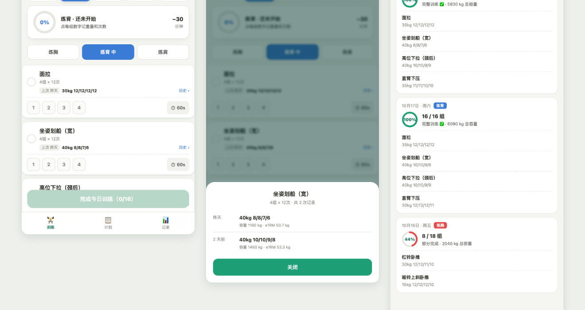
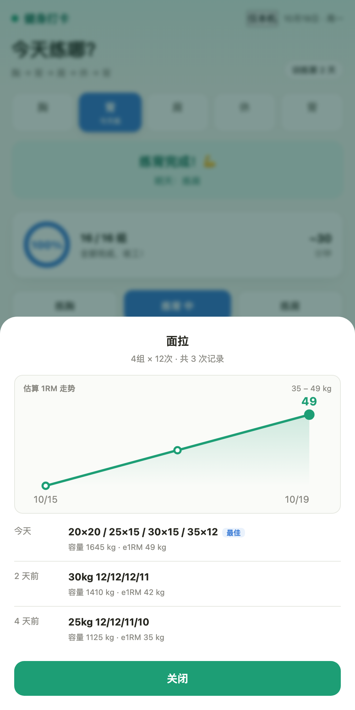

# 健康生活 · Health Life

[](https://ubreezing.github.io/health-life/)
[](LICENSE)

Two tiny self-hosted tools for tracking what you eat and what you lift.
Plain HTML, no build step, no account required — your data stays in your own browser and your own database.

两个给自己写的小工具：**轮转饮食记录** 和 **健身打卡**。
纯 HTML 单文件，没有构建流程，数据存在你自己的浏览器里，接上云同步后存在你自己的数据库里。

> 在线版只跑本地模式，数据不会离开你的浏览器。换设备要同步的话，自己接一个数据库，见下文。



---

## 为什么写这个

市面上的饮食和健身 App 大多要求注册账号、订阅会员，数据存在别人服务器上，导出还得付费。

这个项目的取舍很简单：**功能刚好够用，代码全部能看懂，数据永远归你。**

代价是它不会替你做推荐、不会社交、没有云备份（除非你自己接）。如果你要的是这些，用 Keep 或薄荷健康更合适。

## 两个模块

### 轮转饮食（`/diet`）

按「轮转」的思路记录每天吃了什么，而不是每顿从零开始想。

- 食物库 + 每日三餐记录（热量、碳水、蛋白、脂肪）
- 每日合计、目标值和差额
- 历史记录按天归档
- 自定义食物

### 健身打卡（`/fitness`）

按训练部位记录，练完记重量和次数。

- 循环安排训练部位（胸、背、肩…），自动提示今天该练什么
- 每个动作记录 4 组，重量 + 次数
- 动作卡上直接显示「上次练了多少」，点开可以翻完整历史
- 历史里有估算 1RM 折线图（Epley 公式），用来看有没有真的在变强
- 记录页按天摊开，每个动作的重量次数一目了然



## 特点

- **零依赖、零构建**。两个 `index.html`，直接用浏览器打开就能跑。
- **移动端优先**。按 iPhone 尺寸设计，加到主屏幕就是 PWA。
- **数据格式简单**。localStorage 里就是普通 JSON，随时能导出、能迁移。
- **云同步可选**。不配也能用，只是换设备不同步。

## 快速开始

### 直接在线试

<https://ubreezing.github.io/health-life/>

纯本地模式，数据只存在你自己的浏览器里，关掉页面就没了（除非你自己接数据库）。

### 本地跑

```bash
git clone https://github.com/ubreezing/health-life.git
cd health-life/site
python3 -m http.server 8000
```

打开 `http://localhost:8000/diet/` 或 `http://localhost:8000/fitness/`。

> 直接双击 `index.html` 也能用，但 `file://` 下 PWA 和部分浏览器 API 会受限，建议起个本地服务。

## 接自己的云同步（可选）

同步层 `site/sync.js` 不绑定任何后端，只要求一个 **Supabase 风格**的客户端挂在 `window.CloudSDK` 上。

不接也能用，页面右上角会显示「仅本机」。

### 后端要有两张东西

一张 `sync_state` 表，按 `app` 字段存整份快照：

| 字段 | 类型 | 说明 |
| --- | --- | --- |
| `app` | text | `diet` / `fitness`，一行一个应用 |
| `payload` | jsonb | 整份 JSON 快照 |
| `client_ts` | bigint | 客户端毫秒时间戳，用来判定新旧 |
| `rev` | integer | 版本号，每次写入自增 |

再加上邮箱验证码登录，和一把允许匿名读写的公开密钥。

### 客户端要有这些方法

`sync.js` 只调这么多，照这个形状包一层就能换后端：

```js
auth.getSession()
auth.sendOtp(email)
auth.verifyOtp({ email, token })
auth.signOut()

database.from('sync_state').select(cols).eq(k, v).maybeSingle()
database.from('sync_state').insert(body)
database.from('sync_state').update(body).eq('app', app)
```

Supabase 的 JS 客户端基本就是这个形状，写个二十来行的 `CloudSDK.create(opts)` 适配器即可。

### 三步接上

1. 把实现了上面接口的 SDK 放到 `site/vendor/cloud-sdk.js`
2. 复制配置模板：

   ```bash
   cp site/config.example.js site/config.js
   ```

3. 填上你的后端地址和公开密钥：

   ```js
   window.HEALTH_SYNC_CONFIG = {
     endpoint: 'https://your-project.example.com',
     publishableKey: 'pk_xxxxxxxx'
   };
   ```

`site/config.js` 和 `site/vendor/cloud-sdk.js` 都在 `.gitignore` 里，不会被误提交。

上层要实现的接口只有四个：`snapshot` / `restore` / `merge` / `touch`。

### 关于合并

同步默认是**按键合并**，不是整包覆盖。原因是踩过坑：新设备本地为空但时间戳最新，会把云端的历史冲掉。

现在同一天有两个版本时，饮食按 `sid` 取并集，健身取组数多的那份。四个边界情况有单测覆盖（本地全空、本地空记录、本地多一天、两边一致）。

## 数据模型

### 饮食

`localStorage['eatro.rotation.v3']`：

```json
{
  "foods": [{ "id": "...", "name": "鸡胸肉", "kcal": 133, "protein": 24, "carbs": 0, "fat": 5 }],
  "history": [
    { "date": "2026-10-19", "type": "meal", "sid": "m20261019mt",
      "foodName": "麻辣烫", "meal": "lunch", "kcal": 780, "protein": 56, "carbs": 84, "fat": 24 }
  ],
  "settings": { "targetKcal": 1800 },
  "dayOverrides": {}
}
```

### 健身

每天一个键，`localStorage['gym_2026-10-19']`：

```json
{
  "pick": "back",
  "parts": {
    "back": [
      [{"w":20,"r":20},{"w":25,"r":15},{"w":30,"r":15},{"w":35,"r":12}]
    ]
  },
  "rest": false
}
```

`parts[部位][动作序号][组序号]`，`w` 是重量 kg，`r` 是次数。

## 目录

```
site/
  index.html          入口页
  config.example.js   云端配置模板
  sync.js             同步层（合并策略、冲突处理、状态面板）
  vendor/             放自己的云客户端 SDK，见上文
  diet/index.html     饮食记录
  fitness/index.html  健身打卡
design/               设计图与截图
```

## 已知限制

- 没有账号体系，数据隔离靠后端配置。多人使用要自己在数据库层做 RLS。
- 饮食 App 的历史记录存在一个数组里，条数多了会变慢（目前几百条无感）。
- 1RM 是公式估算，次数超过 12 时偏高；跨器械不可比。
- 没有数据导出按钮，暂时要手动从 localStorage 拷。

## License

MIT
